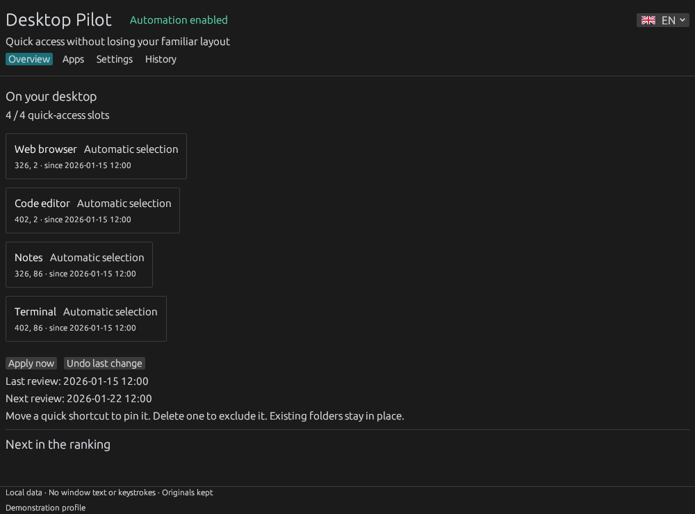

# Desktop Pilot

**Adaptive desktop shortcuts for Windows. Keep useful apps close and your existing layout intact.**

[Download for Windows](https://github.com/TechWisard/desktop-pilot/releases/latest) · [Русский](README.ru.md) · [How it works](docs/guide.md) · [Privacy](docs/privacy.md)


Desktop Pilot is a local Windows desktop organizer and shortcut manager. It learns which apps you use, then maintains a small, stable group of quick-access shortcuts. Your original shortcuts, category folders and manually chosen positions stay under your control.



*The screenshot uses fictional demonstration data.*

## Get started

1. Download the **Windows x64 ZIP archive** (`DesktopPilot-*-windows-x64.zip`) from the [latest release](https://github.com/TechWisard/desktop-pilot/releases/latest) and extract it.
2. Run `desktop-pilot.exe`. The setup walks through the operating mode, number and position of shortcuts, and observation preferences. Choose **English** or **Русский** at any time.
3. Use your computer normally. The default is **passive observation for 7 computer sessions**. No quick shortcuts are created during learning. After the threshold, the most-used eligible apps appear automatically during an idle period. Choose sessions, active days, either condition or both in Settings.

Installation is per user, by default in `%LOCALAPPDATA%\DesktopPilot`; no administrator access is required. Settings are available from the tray icon and the Start menu. This preview executable is unsigned; download only from this repository's Releases and verify the supplied SHA-256 checksum.

## Improvements in 0.2.16

**Less background database activity while idle.** The worker now records a SQLite heartbeat at most once every 15 seconds during normal operation, rather than on every two-second poll. Startup and deliberate commands still update it immediately, and Settings retains its existing 150-second unresponsive-process warning. A deterministic 60-minute scheduler fixture checks 225 actual heartbeat writes instead of the previous per-tick 1,800, without disabling checks or losing recoverability. This is a count of SQLite updates, not a measured battery-life or disk-wear improvement. [Scope and tests](docs/research/2026-10-27-idle-heartbeat.md).

## Improvements in 0.2.15

Working in a different application after a large system-clock jump no longer discards recent session checkpoints for other apps. Cleanup remains bounded by the verified SQLite retention policy; the background worker reloads its cache after cleanup. Transient SQLite writer contention is retried safely before user changes begin; persistent errors remain visible. This prevents accidental loss of session continuity and spurious extra sessions after clock correction. Original shortcuts, placements and manual rules remain unchanged.

## Improvements in 0.2.14

- **Recent usage survives a large forward clock correction.** An apparent gap of more than seven days between cleanup checks temporarily holds time-based deletion for seven days, so a mistaken system clock cannot immediately erase recent app history. A later backward correction releases the hold, and ordinary 90-day retention continues.
- The same protection applies to an existing profile on its first review after upgrading when the saved activity appears unusually old. Event and command logs remain count-bounded. No layout changes, new controls or network data collection. [Reproduction and limitations](docs/research/2026-10-26-forward-clock-retention.md).

## Improvements in 0.2.13

- **Unavailable shortcut sources can recover through a verified identical alias.** If a saved source is locked or partially written, a readable duplicate with the same full launch identity can be used without losing usage history, manual preferences or notes.
- Healthy sources remain stable; existing quick copies are not recreated or moved; a personal launch profile never substitutes for a work profile with different arguments. Original shortcuts are unchanged. [Reproduction and limitations](docs/research/2026-10-26-alias-recovery.md).

## Improvements in 0.2.12

- **Preview matches the protected desktop layout after a clock correction.** If Windows time moves backwards while the original source shortcut is offline, Desktop Pilot no longer incorrectly proposes removing an already managed shortcut just because its saved outage timestamp appears in the future.
- **Your explicit choices remain authoritative.** An existing **Always** or manually moved shortcut stays protected, while automatic copies retain their normal temporary grace after the next verification. **Never add**, changed launch identity, genuinely vacant places and deliberate capacity reductions are still respected. Missing originals never create new quick copies.
- The regression runs through the actual local store, Windows shortcut parser, preview and apply paths, and verifies bytes, file identity and position, plus explicit release to **Never add**. This is not a measured change in user productivity. [Details and limitations](docs/research/2026-10-26-offline-preview-clock-correction.md).

## Improvements in 0.2.11

- **Recover from an incorrect computer clock.** A confirmed new app session is still counted if the last session timestamp was left more than 20 minutes in the future by a backward time correction. Small adjustments do not create false sessions.
- **Automatic reviews no longer wait weeks on a future date.** A checkpoint more than 24 hours ahead is treated as due, but only with your opt-in, learning gate and quiet-desktop condition. An immediate repeat review is not triggered.
- **Keep manual shortcuts where you chose them.** A real Store/desktop regression verifies the corrected clock does not override your automatic-review opt-out, a busy desktop, or existing manually protected files. [Reproduction and limitations](docs/research/2026-10-26-clock-correction-recovery.md).

## Improvements in 0.2.10

- **Your manual choices outlast a disconnected source.** An already managed shortcut marked **Always** or moved by you stays in its familiar place even after the ordinary 72-hour grace period. Returning the unchanged original does not remove and recreate the quick copy.
- **Clear offline explanations in both languages.** The warning explains whether a copy is protected by your choice or only by the temporary grace period; Windows and network paths are preserved exactly.
- Automatic copies still expire normally; **Never add**, changed launch identity, user deletion/edit and explicitly returning to **Automatic** remain authoritative. No new shortcut is created from an unavailable source. [Scenarios and validation](docs/research/2026-10-26-manual-absence-completion.md).

## Improvements in 0.2.9

- **A brief storage lock no longer stops tracking immediately.** When another application temporarily holds SQLite's writer lock, Desktop Pilot makes up to three bounded attempts to save the complete usage transaction. Confirmed time and sessions are recorded only once; persistent and non-lock errors are still reported rather than silently ignored.
- **Clear recovery when tracking stops:** Home shows the saved reason for an unexpected background failure, with **View history** and **Resume background work**. Intentional shutdown and previously saved settings are not mistaken for errors.
- Three additional regressions use the real SQLite store and Home status logic. All 170 Rust tests, native fixtures and release checks passed on both Windows CI environments before the release update. No network account, hidden telemetry or data migration is introduced. [Verification and limits](docs/verification.md).

## Improvements in 0.2.8

- **Keep the usable shortcut:** if a source or drive is temporarily missing and you reduce the number of quick-access slots, Desktop Pilot now removes an unavailable automatic copy before displacing a working one with a lower historical score. Manually chosen **Always** shortcuts still win, and unchanged places are not rearranged.
- **Safer recovery from storage failures:** confirmed app-session timestamps in memory now advance only after their SQLite usage transaction commits. A failed write can no longer leave those two states disagreeing; this is not a claim that all disk failures can be repaired automatically.
- Three new regression tests run on the actual selection, catalog/preview/apply and SQLite transaction paths. Existing original shortcuts, manual placements, 72-hour temporary-outage protection and offline privacy are preserved. [Verification and limits](docs/verification.md).

## Improvements in 0.2.7

- Frequent quick interactions now count toward app recommendations: verified engaged visits of only a few seconds are accumulated per app across window switches for up to 20 minutes, instead of being discarded whenever focus changes.
- Single incidental switches, unsupported input and delays after sleep still do not create usage. At most 128 partial app windows are retained **in memory only**; daily usage data, user choices and manual placements use the same existing rules.
- Windows regressions replay interleaved quick visits through the actual activity accumulator and SQLite store; tests also cover expired visits, incidental switches, memory limits and uninterrupted use. [Verification scope](docs/verification.md).

## Improvements in 0.2.6

- Temporary source or target unavailability no longer forces the next automatic review to remove an already managed shortcut immediately. The program keeps its familiar position for up to 72 hours from the first confirmed outage; it is removed at a later review if the source remains unavailable.
- Missing originals are never used to create new shortcuts. An explicit **Never add** rule, a changed launch identity, or reducing the number of shortcut places still takes precedence.
- Regression tests cover disappearing and restored source files and launch targets, the grace interval, manual exclusions and capacity changes. No extra background timer, cloud account or telemetry has been introduced. [Verification](docs/verification.md).

## Improvements in 0.2.5

- Empty quick-access positions are refilled together at the next review instead of one per review interval. A vacancy does not consume the limit on **replacing** familiar shortcuts.
- Existing shortcuts remain stable: real replacements still require a clear score advantage and respect the configured maximum. Manually protected choices and original files remain unchanged.
- Additional regression tests cover recovery from multiple vacancies and a mixed recovery/replacement review. [Verification](docs/verification.md).

## Improvements in 0.2.4

- Verified Windows Shell apps no longer start with an accidental **Never add** rule merely because their target is not a physical EXE. Invalid targets remain excluded; previously saved manual rules remain unchanged.
- App search also matches launch profile arguments, working directories and personal notes, making same-named shortcuts easier to distinguish.
- Windows regression fixtures exercise Shell discovery, activity, ranking, safe copying and manual exclusions. See the [verification scope](docs/verification.md).

## Earlier interface improvements (0.2.3)

- Larger text, generous buttons, clear navigation and a saved interface scale from 100% to 200%. The selector and Ctrl+plus, Ctrl+minus and Ctrl+0 shortcuts control the same setting.
- Three understandable modes: automatic adaptation, observation with manual changes, or full manual control.
- Pick a shortcut area on a desktop map, or let the app find free space. Advanced tuning is grouped separately.
- Preview which apps will be added or removed before applying. Unsaved settings are clearly distinguished from the running configuration.
- A readable app list with search, filters and direct page selection. Details open separately, and rule-saving progress stays visible beside the affected app. Add multiple shortcuts with the file picker, pasted paths or drag and drop.
- Save initial setup and continue later. Completely disable the app from Data; opening Settings does not silently enable it again.
- Open the downloaded executable to update an existing installation. Your profile is retained. After a failed file replacement, the app attempts to restore the previously running background process and reports any recovery failure separately.

## A quieter desktop

| Behavior | Default after setup |
| --- | --- |
| Quick-access area | 4 shortcuts in a free area of the primary display |
| Review interval | Every 7 days, after an idle period and outside fullscreen activity |
| Ordinary replacements | At most 1 per review |
| Initial observation | 7 qualified computer sessions; configurable sessions / active days / either / both |
| Replacement threshold | 1.5× the existing score **and** at least 3 points more |
| Recency | Scores halve every 14 days; usage totals retained for 90 days |
| Taskbar shortcuts | Already pinned apps excluded unless explicitly requested |
| Manual choices | Always / Automatic / Never; moved quick shortcuts stay pinned |

A computer session needs at least 5 minutes of tracked activity; a new session starts after 30 minutes without it. An active day also needs 5 minutes. Restarting the app preserves progress. Thresholds apply to the initial learning phase; after completion, ordinary weekly reviews take over.

The first fill and explicit rule changes may affect more than one shortcut. Deleting a managed shortcut prevents it from coming back automatically. Files you edit are released from management. Each change has a local journal and an **Undo** action; rollback refuses to overwrite changed files.

## You decide what deserves a shortcut

Usage is more than a launch count. Repeated active days, confirmed foreground sessions, recency, taskbar pins and manual choices contribute to the decision. Opening a process or calling a shortcut adds no ranking points by itself. A foreground window must receive fresh keyboard, button or wheel interaction before its use counts; Windows-marked injected input is excluded. Startup apps can qualify only when you actually interact with them. If an app is normally opened through a file association, a context menu or a hotkey, choose **Never add**. Desktop Pilot cannot reliably infer that preference from process activity alone.

The catalog scans personal and shared desktop shortcuts, together with the Start menu up to five folder levels deep. Add other `.lnk` or `.url` files from Apps. Catalog discovery does not put every application on the desktop. Ambiguous executable profiles are kept separate. Steam game directories and Windows app identities are used where they can be matched uniquely.

Quick shortcuts created with 0.1.1 or later are exact copies of your originals. They launch directly and keep working when Desktop Pilot is stopped or its database is unavailable.

## Local by design

No account, analytics, cloud synchronization or network service. The tracker stores local app paths, daily usage totals, preferences and undo records. It never records key codes, typed text, window titles, document content or browser history. Input provenance flags and a recent interaction timestamp are used to distinguish activity from unattended launches. **Do not upload your local database or undo folder.** [Privacy details](docs/privacy.md)

## Compatibility and verification

Version **0.2.11 is a preview**, intended for Windows 10/11 x64 with the standard Explorer desktop. The release is checked on Windows Server 2022 and 2025 runners, with separate application screenshots and isolated filesystem fixtures. The current verification scope is recorded in the linked report. Automated geometry tests cover 100 combinations of resolution, scaling and desktop origin, including empty, occupied and insufficient-space cases. Those tests do not replace physical multi-monitor testing.

Explorer auto-arrange must be off for positioning. A display-layout change pauses placement until you accept the new geometry. Unrecognized taskbar data stops changes rather than guessing; the pin filter can be disabled explicitly. Alternative shells and virtual-desktop managers are not validated. See [verification scope](docs/verification.md).

## Build

Install Rust **1.93.1** with the MSVC toolchain and Visual Studio C++ Build Tools, then run:

```powershell
pwsh -File scripts/build-release.ps1
```

The script runs formatting, unit tests and Clippy, then builds a release with local source paths remapped. The executable is in `target/release/desktop-pilot.exe`. The app is written in **Rust**, using egui/eframe, SQLite and native Windows Shell APIs.

For isolated native integration checks:

```powershell
target/release/desktop-pilot.exe --self-test --home "$env:TEMP\test-desktop-pilot-unique" --out "$env:TEMP\desktop-pilot-test.json"
```

Use a new, empty `test-*` directory each time. The fixture uses its own shortcut directory and launches only its own inert executable. It does not change the real desktop or startup entries. [Architecture, operation and removal](docs/guide.md)

## Feedback

[Report a bug](https://github.com/TechWisard/desktop-pilot/issues) with the Windows version, display scaling and reproduction steps. Remove personal paths and application history from any report or screenshot.
