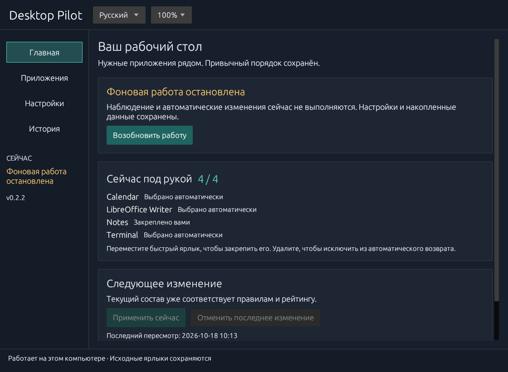

# Desktop Pilot

**Умные ярлыки для Windows: нужные приложения рядом, привычный порядок сохранён.**

[Скачать для Windows](https://github.com/TechWisard/desktop-pilot/releases/latest) · [English](README.md) · [Руководство](docs/guide.ru.md) · [Приватность](docs/privacy.ru.md)


Desktop Pilot — локальный органайзер рабочего стола и менеджер ярлыков Windows. Программа изучает использование приложений и поддерживает небольшую, стабильную группу ярлыков быстрого доступа. Исходные ярлыки, тематические папки и выбранные вручную позиции остаются под вашим контролем.



*На снимке используются вымышленные демонстрационные данные.*

## Начало работы

1. Скачайте и распакуйте **DesktopPilot-0.2.9-windows-x64.zip** на странице [релизов](https://github.com/TechWisard/desktop-pilot/releases/latest).
2. Запустите `desktop-pilot.exe`. Мастер последовательно предложит режим работы, число и место ярлыков, параметры наблюдения. **Русский** или **English** можно выбрать в любой момент.
3. Пользуйтесь компьютером как обычно. По умолчанию включено **пассивное наблюдение за 7 сеансами работы за компьютером**. Во время обучения быстрые ярлыки не создаются. После порога востребованные приложения автоматически появятся во время бездействия. В настройках можно выбрать сеансы, активные дни, любое из условий или оба одновременно.

Программа устанавливается для текущего пользователя, по умолчанию в `%LOCALAPPDATA%\DesktopPilot`, без прав администратора. Настройки доступны через значок в трее и меню «Пуск». Предварительная сборка не имеет цифровой подписи; скачивайте её со страницы релизов этого репозитория и проверяйте опубликованную сумму SHA-256.

## Улучшения версии 0.2.9

- **Кратковременная блокировка базы больше не обрывает учёт с первой ошибки.** Если SQLite временно занята другой записью, программа ограниченно повторяет целиком безопасную транзакцию до трёх попыток. Подтверждённые секунды и сеансы сохраняются однократно; длительные и иные ошибки не скрываются.
- **Понятное восстановление после сбоя:** на главной странице теперь видна сохранённая причина неожиданной остановки фоновой работы, доступны **«Посмотреть историю»** и возобновление. Намеренное отключение не показывается как неисправность.
- Три новых регрессионных теста проверяют настоящую SQLite-базу и логику сообщения на главном экране. До обновления версии все 170 тестов Rust, нативные сценарии и выпускные проверки прошли в обеих средах Windows CI. Миграция данных, аккаунты и скрытая телеметрия не добавлены. [Проверки и ограничения](docs/verification.ru.md).

## Улучшения версии 0.2.8

- **Рабочий ярлык остаётся на месте:** если исходник другого приложения временно недоступен, а вы уменьшаете число мест быстрого доступа, программа сначала освобождает место за счёт недоступной автоматической копии. Раньше она могла удалить работающий ярлык с меньшим прошлым рейтингом. Явное правило **«Всегда»** и сохранённые вручную места по-прежнему приоритетны.
- **Согласованность при ошибке записи:** время последнего сеанса теперь обновляется в оперативной памяти только после успешного сохранения статистики в SQLite. Отказ записи не оставляет частично обновлённое состояние; автоматическое устранение любых ошибок диска этим не гарантируется.
- Три регрессионных теста проверяют настоящее ядро выбора, обнаружение, предварительный просмотр, создание/удаление копий и сбой транзакции. Исходные файлы, ручные решения, 72-часовая защита от временной недоступности и локальность данных сохранены. [Проверки и ограничения](docs/verification.ru.md).

## Улучшения версии 0.2.7

- **Короткие обращения тоже учитываются:** подтверждённая работа в приложении по несколько секунд суммируется между переключениями окон в течение 20 минут. Раньше каждый переход сбрасывал такие наблюдения, и часто используемое приложение могло не получать статистику.
- Случайные переключения, отсутствие взаимодействия и задержки после сна не дают ложных наблюдений. Не более 128 промежуточных записей живут **только в оперативной памяти**. База данных, ручные правила, размещение значков и приватность не изменены.
- Добавлены регрессионные сценарии: чередование коротких обращений к двум приложениям с записью в настоящую SQLite-базу, истечение 20 минут, ложные переключения, граница памяти и сохранение длинных рабочих сеансов. [Границы проверки](docs/verification.ru.md).

## Улучшения версии 0.2.6

- **Временная недоступность без потери ярлыка:** если исходный ярлык или цель запуска временно исчезли, ранее размещённая копия сохраняется при пересмотре в течение 72 часов с момента первого обнаружения. Если источник не восстановлен, копия может быть удалена при следующем пересмотре после истечения срока.
- **Уважение к вашим решениям:** новые ярлыки из недоступных источников не создаются; ручное «Не добавлять», изменение цели запуска и уменьшение количества мест действуют без отсрочки.
- Тесты охватывают отключение и восстановление исходника или цели, истечение срока защиты, запреты и сокращение мест. Новые фоновые таймеры и телеметрия не добавлены. [Границы проверки](docs/verification.ru.md).

## Улучшения версии 0.2.5

- **Свободные места заполняются за один пересмотр:** если несколько быстрых ярлыков исчезли или были исключены, подходящие приложения могут занять все доступные места при ближайшем пересмотре, а не по одному за неделю.
- **Привычный порядок защищён:** ограничение числа замен по-прежнему действует на вытеснение существующих ярлыков. Преимущество в рейтинге и ручное закрепление сохраняют силу.
- Добавлены проверки совместного заполнения пустот и единственной допустимой замены. [Границы проверки](docs/verification.ru.md).

## Улучшения версии 0.2.4

- Ярлыки системных приложений с проверенной целью `shell:` больше не получают ошибочно правило **«Не добавлять»** только из-за отсутствия пути к EXE. Недействительные цели исключаются, ранее сохранённые ручные правила остаются неизменными.
- В разделе **«Приложения»** поиск теперь учитывает аргументы запуска, рабочие каталоги и заметки — можно отличить одноимённые ярлыки разных профилей.
- Регрессионные тесты Windows проверяют обнаружение системных ярлыков, учёт активности, выбор, побайтовую сохранность исходника и ручной запрет. См. [границы проверки](docs/verification.ru.md).

## Улучшения интерфейса из версии 0.2.3

- Крупный текст, просторные кнопки, понятные разделы и сохраняемый масштаб интерфейса от 100% до 200%. Выбор в окне и сочетания Ctrl+плюс, Ctrl+минус и Ctrl+0 управляют одной настройкой.
- Три режима: автоматическая подстройка, наблюдение с применением по кнопке и ручное управление.
- Выбор места для ярлыков на схеме рабочего стола и поиск свободной области одной кнопкой. Подробные параметры вынесены отдельно.
- Предварительный просмотр добавляемых и убираемых приложений. Несохранённые настройки чётко отделены от действующих.
- Читаемый список приложений с поиском, фильтрами и прямым переходом к странице. Подробности открываются отдельно, а сохранение правила видно у выбранного приложения. Несколько ярлыков можно добавить сразу: выбрать файлы, вставить пути или перетащить их в окно.
- Начальную настройку можно сохранить и продолжить позже. Полное отключение доступно в разделе «Данные»; открытие настроек не включает программу обратно.
- Обновление запуском скачанного EXE: фоновый процесс заменяется, настройки и история сохраняются. При неудачной замене файла программа пытается восстановить ранее работавший фон и отдельно сообщает о неудаче восстановления.

## Рабочий стол без постоянных перестановок

| Параметр | После первоначальной настройки |
| --- | --- |
| Область быстрого доступа | 4 ярлыка в свободной области основного монитора |
| Пересмотр | Раз в 7 дней, во время бездействия и вне полноэкранных приложений |
| Обычные замены | Не более 1 за пересмотр |
| Первоначальное наблюдение | 7 полноценных сеансов; настраиваются сеансы / активные дни / любое / оба условия |
| Порог замены | Преимущество в 1,5 раза **и** минимум на 3 балла |
| Давность | Вес уменьшается вдвое за 14 дней; статистика хранится 90 дней |
| Панель задач | Закреплённые приложения исключаются, кроме ручного выбора |
| Ручное управление | Всегда / Автоматически / Не добавлять; перемещённые быстрые ярлыки закрепляются |

Сеанс засчитывается после 5 минут учтённой активности; новый начинается после 30 минут без неё. Активный день тоже требует 5 минут. Перезапуск программы сохраняет прогресс. Порог применяется к первоначальному обучению; затем действует обычный еженедельный пересмотр.

Первоначальное заполнение и явные изменения правил могут затронуть несколько ярлыков. Удалённый вручную быстрый ярлык не возвращается автоматически. Изменённые пользователем файлы выходят из-под управления. Все изменения имеют журнал и **Откат**; откат не перезаписывает изменённые файлы.

## Удобство важнее одного счётчика

Учитываются разные дни активности, подтверждённые сеансы работы в окне, давность, закрепления панели задач и ручные правила. Сам запуск процесса или вызов ярлыка не добавляет баллов. Окно учитывается только после нового взаимодействия клавиатурой, кнопками мыши или колесом; ввод с признаком программной имитации Windows исключается. Приложение из автозагрузки может попасть в выбор только при взаимодействии с ним. Для программы, которую вы открываете через документ, контекстное меню или горячую клавишу, выбирайте **Не добавлять**. По активности процесса нельзя надёжно угадать такое предпочтение.

Каталог собирается из ярлыков личного и общего рабочего стола, а также меню «Пуск» до пяти уровней вложенности. Другие `.lnk` и `.url` можно добавить в разделе «Приложения». Обнаружение приложений не переносит их все на рабочий стол. Неоднозначные профили одного EXE не объединяются. Игры Steam и приложения Windows сопоставляются по отдельным каталогам или идентификаторам, когда соответствие однозначно.

Быстрые ярлыки версии 0.1.1 и новее — точные копии исходных. Они запускают приложения напрямую и работают при остановленном Desktop Pilot или недоступной базе.

## Данные остаются на компьютере

Без учётной записи, аналитики, облачной синхронизации и сетевого сервиса. Локально хранятся пути приложений, дневные счётчики, настройки и данные отката. Программа не записывает коды клавиш, набранный текст, заголовки окон, содержимое документов или историю браузера. Используются только признаки происхождения ввода и время последнего взаимодействия. **Не публикуйте свою базу данных и папку отката.** [Подробности](docs/privacy.ru.md)

## Совместимость и проверки

Версия **0.2.8 — предварительная**, предназначена для Windows 10/11 x64 со стандартным рабочим столом Проводника. Релиз проверяется на средах Windows Server 2022 и 2025; отдельно проверяются экраны приложения и операции в изолированных каталогах. Точные результаты приведены в отчёте ниже. Автоматические тесты геометрии охватывают 100 сочетаний разрешения, масштаба и начала координат, а также пустой, занятый и слишком маленький рабочий стол. Это не заменяет испытания на физических многомониторных системах.

Для размещения нужно отключить автоупорядочивание Проводника. При изменении геометрии размещение приостанавливается до её подтверждения. Неизвестный формат закреплений панели задач останавливает изменения; фильтр можно явно отключить. Альтернативные оболочки и менеджеры виртуальных рабочих столов не проверены. [Границы проверки](docs/verification.ru.md)

## Сборка

Установите Rust **1.93.1** с MSVC и Visual Studio C++ Build Tools:

```powershell
pwsh -File scripts/build-release.ps1
```

Скрипт проверяет форматирование, тесты и Clippy, затем собирает `target/release/desktop-pilot.exe` с заменой локальных путей сборки. Программа написана на **Rust**: egui/eframe, SQLite и Windows Shell API. [Устройство, использование и отключение](docs/guide.ru.md)

## Обратная связь

[Сообщить об ошибке](https://github.com/TechWisard/desktop-pilot/issues): укажите версию Windows, масштаб экрана и шаги воспроизведения. Удалите личные пути и историю приложений из отчётов и снимков.
