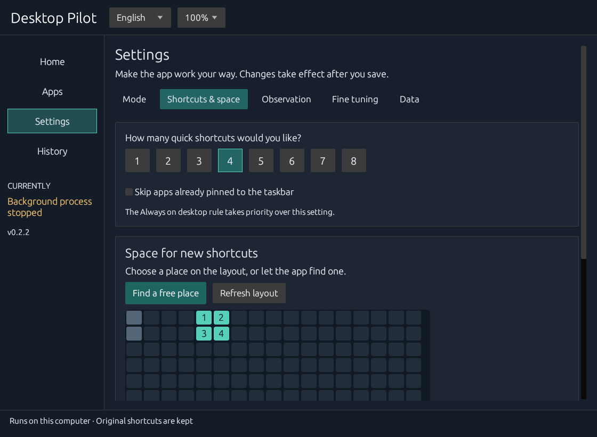

# User guide

[Русский](guide.ru.md) · [Home](../README.md)

## First launch

Setup is divided into short steps: choose how the app should work, set shortcut count and observation preferences, then choose an area on the desktop. Opening setup does not start collection or enable startup. **Start using Desktop Pilot** installs the per-user executable and starts the background process. Closing setup offers to save your choices and current step, discard them or continue editing. A saved draft resumes on the next launch and does not enable observation by itself.

The catalog reads personal and shared desktop shortcuts, together with the Start menu, including folders up to five levels deep. Filesystem links, source/dependency folders and shortcut archives are skipped. An inaccessible subfolder does not cancel the entire scan. The scan is limited to 3,000 files; a warning appears if the limit is reached, and existing catalog entries are retained. Add other `.lnk` or `.url` files from Apps: select several files, paste one path per line or drag files into the window. Existing rules and history are preserved. The recently added list opens after import, even if a previous search or filter would have hidden the new entries.

Windows Known Folders are used for redirected desktops. An explicit `--home` always selects that profile. A normal launch recognizes a profile beside the installed executable before falling back to `%LOCALAPPDATA%\DesktopPilot`.

## Everyday use

| Section | What you can do |
| --- | --- |
| **Home** | See the actual operating state, observation progress, current shortcuts and the proposed changes. Apply a reviewed selection or undo a placement. |
| **Apps** | Search and filter the catalog, inspect why an app is selected, and choose Always on desktop / Automatic selection / Never add. Detailed statistics and paths open separately. |
| **Settings → Mode** | Choose automatic adaptation, observation only, or manual control. Set Windows startup. |
| **Settings → Shortcuts & space** | Choose 1–8 shortcuts, click an area on the desktop map, or find a free area automatically. |
| **Settings → Observation** | Choose the initial learning requirement in sessions or active days. |
| **Settings → Fine tuning** | Adjust review intervals, replacement limits and ranking thresholds. |
| **Settings → Data** | Review local data, clear usage history or completely disable the app with confirmation. |
| **History** | Review completed operations and errors. |

Language and interface scale are available at the top of the window. English/Russian and 100%/125%/150% scale save immediately. Other settings are drafts until **Save** is selected; **Discard edits** restores the saved values. Closing with unsaved edits offers save, discard or return to the window. Settings changed in the tray while you are editing are preserved, or a conflicting edit is reported.

In **Apps**, **Ctrl+F** focuses search and **F5** refreshes the data. **Show in folder** opens the original shortcut in Explorer. When Always rules exceed available slots, a warning shows the count and provides a link to the slot settings.

### Choose a mode

**Adapt automatically** collects activity and updates shortcuts after learning, during idle periods. **Observe only** collects activity and shows suggestions, while placement requires your action. **Control manually** stops new activity collection and removes the learning requirement; choose apps explicitly and apply them yourself.

### Choose where shortcuts go



Open **Settings → Shortcuts & space**. Select the number of shortcuts and use **Find a free place**, or click on the desktop map. Occupied cells are shown separately from the selected area. The selection is checked against the complete Explorer grid, including space for captions. Save the settings before applying a placement. Changing the area determines where new shortcuts are placed; existing manually chosen positions are preserved.

Manual app rules are sent to the background process. A progress indicator remains visible until completion, and failures are shown. Apply and rule actions are unavailable while conflicting operations are in progress. The Home preview uses saved settings, so it describes the configuration that will actually run.

A rule change or slot reduction may remove more than the ordinary replacement limit. More manual pins than slots blocks placement until you increase the capacity or release a pin. Moving or renaming a managed quick shortcut pins its position. Deleting or moving it out of the desktop excludes it from automatic return. Editing its contents releases ownership. Original catalog shortcuts are never adopted as managed copies. Existing category folders are not reorganized.

## How ranking works

For each local calendar day:

```text
daily score = 2 × min(confirmed foreground sessions, 12)
            + 0.4 × ln(1 + min(active seconds, 3600) / 60)
weight      = 2 ^ (-age in days / half-life in days)
total       = sum(daily score × weight)
```

Foreground observations are sampled every two seconds. A qualifying session needs approximately ten seconds of activity; sessions within twenty minutes are deduplicated. Idle periods and long gaps between observations are not counted as active work. Default idle cutoff: 120 seconds.

A process launch, autostart or foreground activation alone gives no score. A new foreground window must receive fresh, non-injected keyboard/button/wheel interaction before the ten-second qualification timer starts. Mouse movement alone is insufficient. New quick shortcuts are byte-identical copies of the originals and launch directly without consulting Desktop Pilot or its database. Legacy launch requests are retained only for compatibility and do not affect ranking or active-day eligibility. Startup apps remain eligible if you actually work in them. Windows-reported injected input is rejected, including ordinary SendInput automation. Virtual input drivers can appear as hardware; the app cannot prove the identity or intention of a person. Controller-only use, passive playback and interactions inaccessible at the current integrity level can be undercounted; use a manual rule for those cases. Two shortcuts using the same executable but different arguments or working directories are distinct identities; ambiguous foreground matches are skipped. Steam games can match a unique installation directory; Windows app shortcuts can match a unique application ID.

Fresh profiles begin with passive learning for 7 qualified **computer sessions**, independent of app switches. Configure 1–100 sessions or 1–90 active days, with Sessions / Days / Either / Both modes. A session requires 5 minutes of tracked activity; 30 minutes without tracked activity starts a new session. An active calendar day requires 5 minutes in total, even across shorter visits. Merely leaving the PC off does not advance the day requirement. Progress is saved locally and survives restarts. While learning is pending, both manual Apply and automatic placement are blocked; disabling the learning requirement is an explicit override. After the threshold is reached, the first fill waits only for an eligible app and a safe idle moment, not an additional weekly interval. The per-app active-day filter defaults to one day and remains adjustable. Increasing thresholds after learning has completed does not start a new learning phase. The first eligible fill can use all available slots. Subsequent automatic reviews run every seven days, after at least fifteen seconds of user inactivity, outside fullscreen activity and mouse dragging. Default ordinary replacement limit: one; a challenger must exceed the current score by both 1.5× and 3 points. Existing valid shortcuts do not disappear just because history was cleared or aged out.

Manual choices override ranking. Taskbar pins are excluded by default. Context-menu, file-association and hotkey preferences must be expressed with **Never add**. The app cannot determine those preferences reliably on its own.

## Placement and recovery

The shortcut area uses Explorer's grid on the primary monitor. Initial setup finds an unoccupied area; existing items are included in the positioning batch so that Explorer does not shift them. Full grid cells are reserved, including space for captions. Long quick-shortcut names are shortened; the original name and shortcut are retained in the catalog.

Display geometry changes, unexpected taskbar formats, an occupied area or an interrupted transaction pause placement. Fix the reported condition, or explicitly disable the taskbar filter when appropriate. **Accept current layout** acknowledges the current display layout; it does not move existing icons.

Each transaction records before/after state and backup bytes before changing files. Undo checks hashes before removing or restoring a file. If a user edited a file, it stops instead of overwriting the edit. Undo pauses automatic changes. New quick shortcuts preserve the original file bytes, extension, arguments, working directory, icon and elevation behavior. They remain usable if Desktop Pilot is stopped or its catalog is unavailable.

## Disable or remove

To disable the app completely, open **Settings → Data → Disable Desktop Pilot**. This stops the background process, observation, automatic changes and Windows startup. Shortcuts and local data remain. Opening Settings or updating does not undo this choice; resume explicitly from the window.

To also undo managed changes in sequence, extract the release archive and run:

```powershell
powershell -NoProfile -File .\disable.ps1
```

This stops the background process, disables tracking and startup, and undoes managed changes. `-KeepShortcuts` disables the tracker while retaining quick shortcuts; shortcuts created with 0.1.1 or later launch independently. Older 0.1.0 wrappers still require Desktop Pilot and its profile.

Local data is retained for recovery. After undo completes successfully and no managed shortcuts remain, you can remove `%LOCALAPPDATA%\DesktopPilot` and the `Desktop Pilot` Start menu shortcut. Before removing local data, replace any remaining 0.1.0 wrappers with copies of the originals. If undo reports a conflict, resolve it before removing the application.

## Update

Close the existing Settings window, extract the new release and run its `desktop-pilot.exe`. The current executable is installed safely, the previous background process is stopped and the new one starts using the same profile. A completely disabled profile stays disabled. If another version of Settings is still open, the app asks you to close it; unsaved edits are not discarded automatically. Settings, usage history, app rules and undo data are retained. The previous executable is kept as a local backup. An unsuccessful atomic file replacement leaves the installed copy intact and restores the previously running background process. The installer checks the installed executable version and refuses to replace a newer version with an older one. Updates are started by you; there is no background downloader.

On restart, unfinished commands are cancelled with a history entry. Old placement or undo requests are not replayed without a new request. Diagnostic reports are written atomically; the database, executable and shortcut paths cannot be used as report destinations.

## Source layout

| Module | Responsibility |
| --- | --- |
| `cli.rs` | Argument validation and command help |
| `report.rs` | Destination checks and atomic diagnostic report writes |
| `model.rs` | Identity, configuration, ranking and stable selection |
| `native.rs` | Windows Shell, desktop geometry, activity and taskbar integration |
| `engine.rs` | Catalog, ownership, transactions, rollback and observation loop |
| `store.rs` | Local SQLite persistence |
| `learning.rs` | Persistent passive observation, computer sessions and active-day thresholds |
| `activity.rs` | Input-provenance filtering and fresh foreground-interaction evidence |
| `profile.rs` | Consistent installed-profile selection across launch environments |
| `setup.rs` | Per-user installation and executable updates |
| `ui.rs`, `i18n.rs`, `tray.rs` | Bilingual settings and tray controls |
