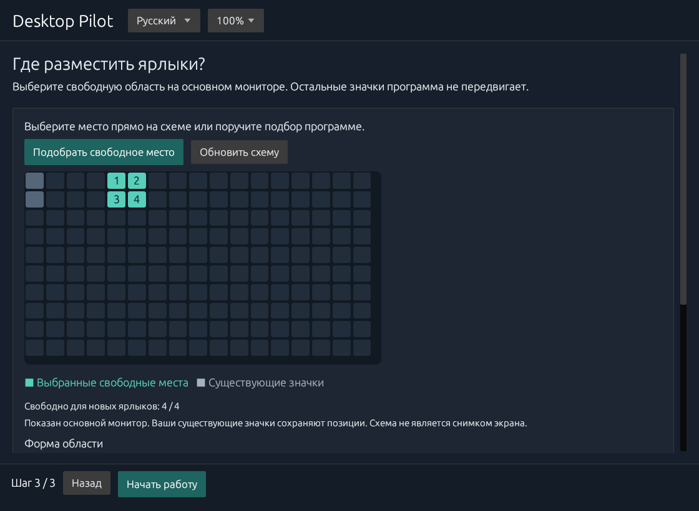

# Руководство

[English](guide.md) · [Главная](../README.ru.md)

## Первый запуск

Мастер настройки разделён на короткие шаги: режим работы, число ярлыков и параметры наблюдения, затем область на рабочем столе. Само открытие мастера не включает сбор активности и автозапуск. Кнопка **Начать работу** устанавливает программу для текущего пользователя и запускает фоновый процесс.

Каталог собирается из ярлыков рабочего стола и меню «Пуск», включая папки до пяти уровней вложенности. Ссылки файловой системы, папки исходников и зависимостей, архивы ярлыков пропускаются. Недоступная вложенная папка не прерывает весь поиск. За один просмотр обрабатывается до 3000 файлов; при достижении лимита выводится предупреждение, существующие записи сохраняются. Другие `.lnk` и `.url` можно добавить в разделе «Приложения».

Пути определяются через Windows Known Folders, в том числе для перенаправленного рабочего стола. Явный параметр `--home` всегда выбирает указанный профиль. При обычном запуске программа сначала проверяет профиль рядом с установленным EXE, затем использует `%LOCALAPPDATA%\DesktopPilot`.

## Ежедневная работа

| Раздел | Что в нём делать |
| --- | --- |
| **Главная** | Проверить действующее состояние программы, прогресс наблюдения, текущие ярлыки и предлагаемые изменения. Применить просмотренный состав или отменить размещение. |
| **Приложения** | Найти приложение, отфильтровать список, узнать причину выбора и задать правило «Всегда на столе / Автоматический выбор / Не добавлять». Статистика и исходный путь раскрываются отдельно. |
| **Настройки → Режим работы** | Выбрать автоматическую подстройку, только наблюдение или ручное управление. Настроить автозапуск. |
| **Настройки → Ярлыки и место** | Выбрать 1–8 ярлыков, указать область на схеме рабочего стола или найти свободное место автоматически. |
| **Настройки → Наблюдение** | Выбрать длительность первоначального наблюдения в сеансах или активных днях. |
| **Настройки → Тонкая настройка** | Изменить период пересмотра, число замен и пороги рейтинга. |
| **Настройки → Данные** | Посмотреть локальные данные и при необходимости очистить историю использования с подтверждением. |
| **История** | Просмотреть результаты операций и ошибки. |

Язык и масштаб интерфейса доступны в верхней части окна. Выбор русского/английского и масштаба 100%/125%/150% сохраняется сразу. Остальные изменения вступают в силу после **Сохранить**; отмена редактирования возвращает сохранённые значения. При закрытии с несохранёнными правками можно сохранить их, отбросить или вернуться в окно. Изменения, внесённые через трей во время редактирования, сохраняются; при конфликте программа сообщает об этом.

### Выбор режима

**Подстраивать автоматически** — собирать активность и обновлять ярлыки после обучения, когда компьютер не занят. **Только наблюдать** — собирать активность и показывать предложения, применять их по вашей кнопке. **Управлять вручную** — прекратить новый сбор активности и снять требование обучения; приложения выбираете и размещаете вы.

### Выбор места для ярлыков



Откройте **Настройки → Ярлыки и место**. Выберите количество ярлыков и нажмите **Подобрать свободное место** либо укажите область на схеме рабочего стола. Занятые ячейки отличаются от выбранной области. Программа проверяет полные ячейки сетки Проводника с местом для подписей. Сохраните настройки перед применением. Изменение области определяет место новых ярлыков; существующие позиции, выбранные вручную, сохраняются.

Ручные правила передаются фоновому процессу. Индикатор остаётся видимым до завершения, при ошибке появляется сообщение. Применение и изменение правил блокируются на время несовместимой операции. Предварительный просмотр на главной использует сохранённые настройки и показывает действующий план.

Изменение правила или уменьшение числа мест может убрать больше ярлыков, чем обычный лимит замен. Если ручных закреплений больше свободных мест, увеличьте число мест или снимите закрепления. Перемещение и переименование быстрой копии закрепляет её позицию. Удаление или перенос за пределы рабочего стола исключает её из автоматического возврата. Изменённое содержимое выводит файл из-под управления. Исходные ярлыки каталога не принимаются за управляемые копии. Тематические папки не переупорядочиваются.

## Рейтинг

За каждый локальный календарный день:

```text
балл дня = 2 × min(подтверждённые сеансы активного окна, 12)
         + 0,4 × ln(1 + min(активные секунды, 3600) / 60)
вес      = 2 ^ (-возраст в днях / период полураспада)
итог     = сумма(балл дня × вес)
```

Активное приложение проверяется раз в две секунды. Сеанс засчитывается после примерно десяти секунд активности; повторные сеансы в пределах двадцати минут объединяются. Бездействие и длинные перерывы наблюдения не засчитываются как активная работа. Порог бездействия по умолчанию — 120 секунд.

Запуск процесса, автозагрузка или появление активного окна сами по себе не дают баллов. Новое активное окно должно получить свежий ввод клавиатуры, кнопок мыши или колеса без признака программной имитации; затем начинается десятисекундная проверка активности. Одного движения мыши недостаточно. Новые быстрые ярлыки побайтно копируют исходные и запускаются напрямую, без обращения к Desktop Pilot и его базе. Запросы старого формата сохранены для совместимости и не влияют на рейтинг и число активных дней. Приложения из автозагрузки могут учитываться при реальной работе с ними. Ввод с признаком внедрения Windows, в том числе обычная автоматизация через SendInput, исключается. Виртуальный драйвер может выглядеть как физическое устройство: личность и намерение человека программа доказать не может. Работа только с контроллером, пассивный просмотр и ввод, недоступный при текущем уровне прав, могут недооцениваться; для них используйте ручное правило. Один EXE с разными аргументами или рабочими каталогами имеет разные идентификаторы; неоднозначные сопоставления пропускаются. Для игр Steam учитывается уникальный каталог установки, для приложений Windows — уникальный идентификатор приложения.

Новый профиль начинает с пассивного наблюдения за 7 полноценными **сеансами работы за компьютером**, независимо от переключений приложений. Настраиваются 1–100 сеансов или 1–90 активных дней и режим «Сеансы / Дни / Любое / Оба». Сеанс требует 5 минут учтённой активности; после 30 минут без неё начинается новый. Активный календарный день требует суммарно 5 минут, в том числе из нескольких коротких посещений. Выключенный компьютер не приближает порог дней. Прогресс сохраняется локально между перезапусками. Пока обучение не завершено, ручное применение и автоматическое размещение блокируются; явно отключённое требование обучения снимает эту блокировку. После достижения порога нужно дождаться только подходящего приложения и безопасного момента бездействия, дополнительной недели ожидания нет. Фильтр по активным дням отдельного приложения по умолчанию равен одному дню и настраивается отдельно. Увеличение порогов после завершения обучения не начинает его заново. Первоначальное заполнение может занять все места. Затем пересмотр происходит раз в семь дней, при бездействии от пятнадцати секунд, вне полноэкранного приложения и перетаскивания мышью. Обычно меняется не более одного ярлыка; новый должен опережать прежний в 1,5 раза и минимум на 3 балла. Действующие ярлыки не исчезают только из-за очистки или устаревания статистики.

Ручные решения приоритетнее рейтинга. Закрепления панели задач исключаются по умолчанию. Для приложений, запускаемых через контекстное меню, файлы или горячие клавиши, задавайте **Не добавлять**: автоматически надёжно определить такое предпочтение нельзя.

## Размещение и восстановление

Используется сетка Проводника на основном мониторе. При первом запуске выбирается свободная область. Позиции существующих объектов включаются в общую операцию размещения, чтобы Проводник их не сдвинул. Резервируется целая ячейка сетки с местом для подписи. Длинные имена быстрых копий сокращаются; оригинальное имя и ярлык остаются в каталоге.

Изменение геометрии, неизвестный формат панели задач, занятая область или незавершённая операция останавливают размещение. Устраните указанную причину либо явно отключите фильтр панели задач. **Принять текущее размещение** подтверждает текущую конфигурацию экранов, сохраняя позиции значков.

Перед изменением файлов сохраняются предыдущие/новые параметры и резервные байты. Откат проверяет контрольные суммы. При ручном изменении файла он останавливается без перезаписи. После отката автоматика приостанавливается. Новые быстрые ярлыки сохраняют байты исходного файла, расширение, аргументы, рабочий каталог, значок и правила повышения прав. Они работают при остановленном Desktop Pilot и недоступном каталоге.

## Отключение и удаление

Распакуйте архив релиза и выполните:

```powershell
powershell -NoProfile -File .\disable.ps1
```

Скрипт останавливает фон, выключает наблюдение и автозапуск и откатывает управляемые изменения. С ключом `-KeepShortcuts` быстрые ярлыки сохраняются; ярлыки версии 0.1.1 и новее запускаются независимо. Старым ярлыкам-посредникам 0.1.0 по-прежнему нужны программа и её профиль.

Данные остаются для восстановления. После успешного завершения отката, когда управляемых ярлыков больше нет, можно удалить `%LOCALAPPDATA%\DesktopPilot` и ярлык Desktop Pilot в меню «Пуск». Перед удалением данных замените оставшиеся ярлыки-посредники 0.1.0 копиями исходных. Конфликт отката нужно устранить до удаления программы.

## Обновление

Закройте открытое окно настроек, распакуйте новый релиз и запустите его `desktop-pilot.exe`. Программа установит текущий EXE, корректно остановит старый фоновый процесс и запустит новый с тем же профилем. Настройки, история, правила и данные отката сохраняются. Предыдущий EXE сохраняется в локальной резервной копии. Если атомарная замена файла не удастся, установленная копия остаётся на месте. Обновление запускаете вы; фоновой загрузки нет.

## Исходный код

| Модуль | Назначение |
| --- | --- |
| `cli.rs` | Проверка аргументов и справка командной строки |
| `model.rs` | Идентификаторы, настройки, рейтинг и стабильный выбор |
| `native.rs` | Windows Shell, геометрия, активность, панель задач |
| `engine.rs` | Каталог, управление ярлыками, операции, откат и наблюдение |
| `store.rs` | Локальная база SQLite |
| `learning.rs` | Пассивное наблюдение, сеансы за компьютером и пороги активных дней |
| `activity.rs` | Фильтрация происхождения ввода и подтверждение взаимодействия с окном |
| `profile.rs` | Единый установленный профиль при разных способах запуска |
| `setup.rs` | Установка для пользователя и обновление EXE |
| `ui.rs`, `i18n.rs`, `tray.rs` | Двуязычные настройки и трей |
